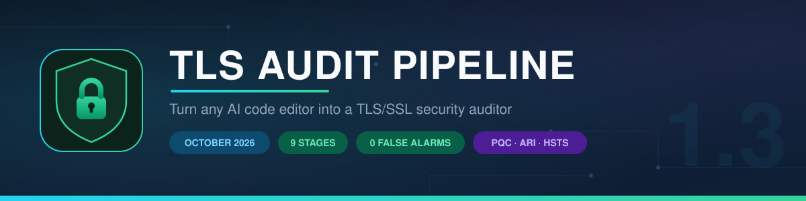
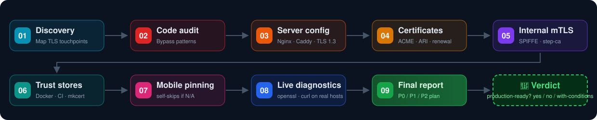

<div align="center">



### حوّل أي محرر أكواد بالذكاء الاصطناعي إلى **مدقق أمني لـ TLS/SSL** 🔍

*تقارير جاهزية بالإثباتات لأي مشروع — مقابل baseline أكتوبر 2026 الهندسي.*

[](LICENSE)
[](#-تظبيط-الـ-pipeline-مع-الزمن)
[](#-المراحل-التسعة)
[](#-اتجرّب-على-مشروع-حقيقي)
[](#-طريقة-الاستخدام)

**[طريقة الاستخدام](#-طريقة-الاستخدام) · [المراحل التسعة](#-المراحل-التسعة) · [الدليل إنه شغال](#-اتجرّب-على-مشروع-حقيقي) · [مثال حي](examples/gitea-audit-2026-10.md) · [English](README.md)**

</div>

---

## 🧪 اتجرّب على مشروع حقيقي

الـ pipeline اتنفذ **end-to-end** على [Gitea](https://github.com/go-gitea/gitea) — مشروع ناضج ومنشور على نطاق واسع — شامل اختبارات شبكة حية:

| | |
|:---|:---|
| 🎯 **نتايج حقيقية** | **3 / 3** — كل اكتشاف كان صح |
| 🚫 **إنذارات كاذبة** | **0** |
| 🏷️ **دقة التصنيف** | **3 / 3** صح (hardening → P1، مش P0 متضخم) |
| 🕵️ **أمسك ما لا يراه الفحص الثابت** | `dl.gitea.com` لسه بيقبل **TLS 1.0/1.1** في الإنتاج |
| 🧠 **تفادى إنذار كاذب كلاسيكي** | كان ممكن نفترض إن ACME المدمج `autocert` قديم → الحقيقة `certmagic` بدعم **ARI** كامل |

➡️ اقرأ تقرير التشغيل الحقيقي كامل: [`examples/gitea-audit-2026-10.md`](examples/gitea-audit-2026-10.md)

## 🧭 بيعمل إزاي كده؟

كل برومبت **Self-contained** — بيشيل معاه حقائق ومعايير أكتوبر 2026 كاملة (التشفير ما بعد الكم `X25519MLKEM768`، إيقاف OCSP ومعيار **ARI** RFC 9773، جدول الشهادات 200→100→47 يوم، فخ 0-RTT...). مش محتاج الدرس المرجعي جنبك: الصق برومبت واحد في أي محرر وهيشتغل.



## 🚀 طريقة الاستخدام

### ⚡ الطريقة الأولى: مرحلة بمرحلة *(الأدق)*

1. افتح مشروعك في المحرر.
2. افتح ملف المرحلة (مثلاً [`01-discovery.md`](01-discovery.md)) وانسخ البرومبت.
3. الصقه في الـ agent واستنى التقرير.
4. التقرير طلع **N/A**؟ اتخطى المجال ده خالص — مفيش موبايل؟ مقدّش تفتح المرحلة 07.

### 📦 الطريقة الثانية: تسليم الـ pipeline كله *(الأسرع)*

اعمل clone للريبو جوه (أو جنب) مشروعك، وبعدين الصق **برومبت واحد**:

```text
Read this tls-audit-pipeline repository and execute the stages in order from 01 to 09.
- For each stage: run the CHECK prompt first and show me its report before moving on.
- If a stage's report says غير منطبق (N/A), skip it and continue.
- Do NOT run any FIX prompt unless I approve the proposed changes first.
- At the end, run stage 09 to produce the consolidated final report.
```

<details>
<summary><b>🛡️ الـ agent مسموحله يعمل إيه؟ (مبني جوه كل برومبت)</b></summary>

- الفحص **read-only** بدقة — الإصلاح بيحصل بس عن طريق برومبت الإصلاح وبعد موافقتك على الخطة.
- كل نتيجة لازم تطلع بإثبات (`file:line`) — ممنوع الكلام من غير دليل.
- ممنوع طباعة private keys أو أسرار — المسارات بس.
- انضباط التصنيف: **P0 = ثغرة قابلة للاستغلال**، والـ hardening بيبقى P1. (التظبيط ده هو اللي خلّى تجربة Gitea بصفر إنذارات كاذبة.)

</details>

## 📦 المراحل التسعة

| # | المرحلة | بتفحص إيه | Ref |
|:---:|---|---|:---:|
| 01 | 🔎 [**الاكتشاف**](01-discovery.md) | بترسم خريطة **كل** نقاط TLS: سيرفرات، عملاء HTTPS، شهادات، Docker، CI، موبايل — وبتحديد أنهي مراحل منطبقة | — |
| 02 | 🚨 [**تدقيق الكود**](02-code-audit.md) | أنماط تعطيل التحقق القاتلة: `rejectUnauthorized: false`، `verify=False`، `InsecureSkipVerify`، `curl -k`... | §4ب |
| 03 | 🖥️ [**إعدادات السيرفر**](03-server-config.md) | Nginx / Caddy / Traefik مقابل baseline 2026: TLS 1.3، `X25519MLKEM768`، حماية 0-RTT، منع `ssl_stapling` | §1د §3 |
| 04 | 📜 [**الشهادات**](04-certificates.md) | ACME + **ARI**، مراقبة الانتهاء، لا اعتماد على الإيميلات، جدول الصلاحيات المتقلص | §2 |
| 05 | 🔐 [**mTLS الداخلي**](05-mtls-internal.md) | منع الشهادات العامة كـ client certs (LE شالت ClientAuth EKU!)، بدائل SPIFFE/SPIRE/mesh/step-ca | §4أ |
| 06 | 🐳 [**مخازن الثقة**](06-trust-containers.md) | `NODE_EXTRA_CA_CERTS`، `update-ca-certificates` في Docker، `mkcert` للـ localhost | §4ب |
| 07 | 📱 [**Pinning الموبايل**](07-mobile-pinning.md) | تثبيت الـ leaf certificate = وقوع التطبيق مضمون عند أول تجديد؛ البديل SPKI root | §4ج |
| 08 | 🌐 [**التشخيص الحي**](08-verify-commands.md) | اختبارات `openssl`/`curl` حقيقية على **دوميناتك** — بتطلب إذنك قبل لمس الشبكة | §5 |
| 09 | 🏁 [**التقرير النهائي**](09-final-report.md) | حكم نهائي موحد 🟢🟡🔴 + خطة إصلاح مرتبة P0/P1/P2 | ★ |

<details>
<summary><b>📋 صيغة التقرير الموحدة — كل مرحلة بتطلعها</b></summary>

1. **الجاهزية** — ✅ جاهز | ⚠️ جاهز جزئياً | ❌ غير جاهز | ➖ غير منطبق (N/A)
2. **الموجود حالياً** — كل بند بإثبات (`file:line`)
3. **الناقص أو المخالف** — كل بند بأولوية P0 / P1 / P2
4. **المطلوب عمله** — بالترتيب، مع الوضع النهائي المستهدف

التقارير بتطلع **بالعربي والمصطلحات التقنية بالإنجليزي** بالتصميم. فريق ناطق بالإنجليزية؟ غيّر سطر واحد في قسم `OUTPUT FORMAT` داخل كل برومبت من *"in Arabic"* إلى *"in English"* — مفيش أي تغيير تاني.

**جربة من تقرير نهائي حقيقي** (من تشغيل Gitea):

> | المجال | الحالة | P0 | P1 | P2 |
> |---|---|---|---|---|
> | أنماط الكود | ⚠️ | 0 | 1 | 2 |
> | إعدادات السيرفر | ⚠️ | 0 | 1 | 2 |
> | دورة حياة الشهادات | ✅ | 0 | 0 | 2 |
> | الموبايل (Pinning) | ➖ N/A | — | — | — |
>
> **الحكم النهائي: 🟡 جاهز بشروط** — مفيش أي P0، لكن فيه P1 اتنين لازم يتصلحوا.

</details>

## 🗓️ تظبيط الـ pipeline مع الزمن

معايير 2026 بتتشد باستمرار:

```
200 يوم (دلوقتي) ──► 100 يوم (مارس 2027) ──► 47 يوم (مارس 2029)
```

- أعد تشغيل الـ pipeline كامل **كل ربع سنة**، وقبل كل release كبيرة.
- شغّل دايماً **المرحلة 08 على دوميناتك الإنتاجية أنت** قبل أي حكم جاهزية — فحص الريبو بيشوف الكود، **مش الـ deployment بتاعك**.

## 🤝 المساهمة

لقيت قاعدة baseline ناقصة من 2026 أو نمط bypass جديد؟ افتح issue أو PR — البرومبتات self-contained، فالإضافات تراكمية وآمنة.

## 📜 الرخصة

[MIT](LICENSE) © 2026 [Hussein El-Daramally](https://github.com/s7so)

<div align="center">
<sub>لو الـ pipeline ده منع مفاجأة TLS في الإنتاج بتاعك — فكّر في ⭐ للريبو.</sub>
</div>
