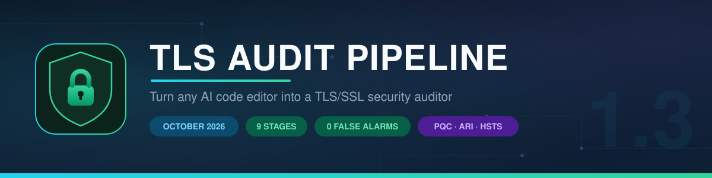
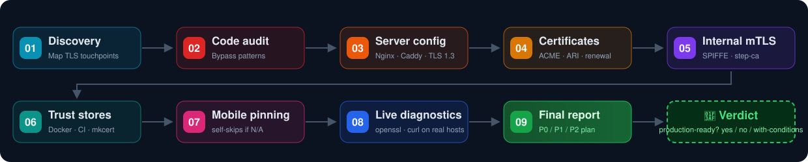

<div align="center">



### Turn any AI code editor into a **TLS/SSL security auditor** 🔍

*Evidence-based readiness reports for any project — mapped against the October 2026 baseline.*

[](LICENSE)
[](#-keeping-it-current)
[](#-the-nine-stages)
[](#-validated-on-a-real-project)
[](#-quick-start)

**[Quick start](#-quick-start) · [The 9 stages](#-the-nine-stages) · [Proof it works](#-validated-on-real-projects) · [Live examples](examples/) · [العربية](README.ar.md)**

</div>

---

## 🧪 Validated on real projects

This pipeline was executed **end-to-end** against 3 world-class open-source projects across different ecosystems and architectures (Go, Node.js, and DevOps / Nginx Reverse Proxies) — including live network diagnostics:

| Project | Ecosystem / Role | True Positives | False Alarms | Key Finding | Full Audit Report |
|---|---|:---:|:---:|---|:---:|
| [**Gitea**](https://github.com/go-gitea/gitea) | Go (Git Platform) | **3 / 3** | **0** | `dl.gitea.com` still accepting **TLS 1.0/1.1** in production | [`gitea-audit-2026-10.md`](examples/gitea-audit-2026-10.md) |
| [**Uptime Kuma**](https://github.com/louislam/uptime-kuma) | Node.js (Monitoring) | **4 / 4** | **0** | All 3 domains accept **TLS 1.0/1.1** + Docker trust store mismatch | [`uptime-kuma-audit-2026-10.md`](examples/uptime-kuma-audit-2026-10.md) |
| [**Nginx Proxy Manager**](https://github.com/NginxProxyManager/nginx-proxy-manager) | DevOps / Nginx Proxy | **4 / 4** | **0** | Missing post-quantum `X25519MLKEM768` in templates + non-ARI renewal | [`nginx-proxy-manager-audit-2026-10.md`](examples/nginx-proxy-manager-audit-2026-10.md) |

### 🎯 Why this precision matters
- **Zero False Alarms (0 False Positives):** The pipeline intelligently distinguishes between user opt-in configuration ("ignore TLS" switches) and dangerous hardcoded bypasses.
- **Catches what Static Analysis misses:** Reviewing code alone wouldn't reveal that production edge CDN endpoints accept deprecated TLS 1.0/1.1.
- **Audits Infrastructure Tools Themselves:** Not only audits user apps, but uncovers architectural flaws in tools that generate TLS termination configs for thousands of servers.
- **Strict October 2026 calibration:** Validated against ACME **ARI** (RFC 9773), Post-Quantum `X25519MLKEM768`, and 0-RTT replay protection.

## 🧭 How it works

Each prompt is **self-contained** — it carries its own October 2026 facts and checklist (post-quantum `X25519MLKEM768`, OCSP shutdown + **ARI** RFC 9773, the 200→100→47-day certificate schedule, the 0-RTT replay trap, ...). No reference lesson needed next to you: paste one prompt into any editor and it just works.



## 🚀 Quick start

### ⚡ Mode 1 — stage by stage *(most precise)*

1. Open your project in your AI editor.
2. Open a stage file (e.g. [`01-discovery.md`](01-discovery.md)) and copy its prompt code block.
3. Paste it into the agent, read the report.
4. A stage reports **N/A (غير منطبق)**? Skip that domain entirely — no mobile app? skip stage 07.

### 📦 Mode 2 — hand over the whole pipeline *(fastest)*

Clone this repo into (or next to) your project, then paste **one** prompt:

```text
Read this tls-audit-pipeline repository and execute the stages in order from 01 to 09.
- For each stage: run the CHECK prompt first and show me its report before moving on.
- If a stage's report says غير منطبق (N/A), skip it and continue.
- Do NOT run any FIX prompt unless I approve the proposed changes first.
- At the end, run stage 09 to produce the consolidated final report.
```

<details>
<summary><b>🛡️ What the agent is allowed to do (baked into every prompt)</b></summary>

- Checks are strictly **read-only** — fixes happen only via a FIX prompt, after you approve the plan.
- Every finding must cite evidence (`file:line`) — no vibes-based findings.
- Never prints private keys or secrets — paths only.
- Severity discipline: **P0 = exploitable hole**, hardening gaps = P1. (This calibration is what kept the Gitea validation at 0 false alarms.)

</details>

## 📦 The nine stages

| # | Stage | What it audits | Ref |
|:---:|---|---|:---:|
| 01 | 🔎 [**Discovery**](01-discovery.md) | Maps **every** TLS touchpoint: servers, HTTPS clients, certs, Docker, CI, mobile — then tells you which stages apply | — |
| 02 | 🚨 [**Code audit**](02-code-audit.md) | Deadly verification-bypass patterns: `rejectUnauthorized: false`, `verify=False`, `InsecureSkipVerify`, `curl -k`... | §4b |
| 03 | 🖥️ [**Server config**](03-server-config.md) | Nginx / Caddy / Traefik vs the 2026 baseline: TLS 1.3, `X25519MLKEM768`, 0-RTT guard, no `ssl_stapling` | §1d §3 |
| 04 | 📜 [**Certificates**](04-certificates.md) | ACME + **ARI**, expiry monitoring, no email reliance, the shrinking validity schedule | §2 |
| 05 | 🔐 [**Internal mTLS**](05-mtls-internal.md) | No public-CA client certs (LE removed ClientAuth EKU!), SPIFFE/SPIRE/mesh/step-ca | §4a |
| 06 | 🐳 [**Trust stores**](06-trust-containers.md) | `NODE_EXTRA_CA_CERTS`, `update-ca-certificates` in Docker, `mkcert` for localhost | §4b |
| 07 | 📱 [**Mobile pinning**](07-mobile-pinning.md) | Leaf-certificate pinning = guaranteed app-brick on renewal; the SPKI-root alternative | §4c |
| 08 | 🌐 [**Live diagnostics**](08-verify-commands.md) | Real `openssl`/`curl` tests on **your** domains — asks permission before touching the network | §5 |
| 09 | 🏁 [**Final report**](09-final-report.md) | Consolidated verdict 🟢🟡🔴 + prioritized P0/P1/P2 remediation plan | ★ |

<details>
<summary><b>📋 The unified report format — every stage outputs this</b></summary>

1. **Readiness** — ✅ ready | ⚠️ partially | ❌ not ready | ➖ N/A
2. **What exists** — every item with evidence (`file:line`)
3. **What's missing / violating** — each tagged P0 / P1 / P2
4. **Required actions** — ordered, with the exact target state

Reports are written **in Arabic with English technical terms** (the author's audience). English-only team? Change one line in each prompt's `OUTPUT FORMAT` — from *"write the report in Arabic"* to *"in English"*. Nothing else changes.

**Peek at a real final report** (from the Gitea run):

> | المجال | الحالة | P0 | P1 | P2 |
> |---|---|---|---|---|
> | أنماط الكود | ⚠️ | 0 | 1 | 2 |
> | إعدادات السيرفر | ⚠️ | 0 | 1 | 2 |
> | دورة حياة الشهادات | ✅ | 0 | 0 | 2 |
> | الموبايل (Pinning) | ➖ N/A | — | — | — |
>
> **الحكم النهائي: 🟡 جاهز بشروط** — مفيش أي P0، لكن فيه P1 اتنين لازم يتصلحوا.

</details>

## 🗓️ Keeping it current

The 2026 baseline keeps tightening:

```
200 days (now) ──► 100 days (Mar 2027) ──► 47 days (Mar 2029)
```

- Re-run the full pipeline **quarterly** and before every major release.
- Always run **stage 08 against your own production domains** before judging readiness — the repo audit sees the code, **not your deployment**.

## 🤝 Contributing

Found a missing 2026 baseline rule or a new bypass pattern? Open an issue or PR — the prompts are self-contained, so additions are additive and safe.

## 📜 License

[MIT](LICENSE) © 2026 [Hussein El-Daramally](https://github.com/s7so)

<div align="center">
<sub>If this saved your production from a TLS surprise, consider ⭐ starring the repo.</sub>
</div>
